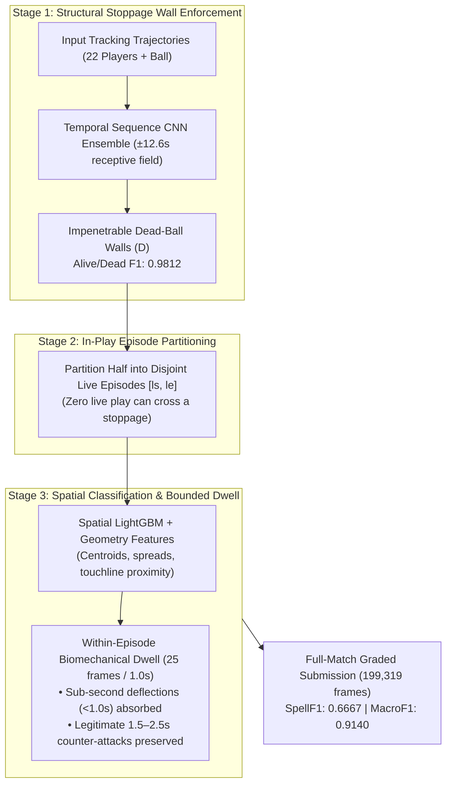

# Technical Document: Hierarchical Episode-First Possession Engine

**Competition:** More Than A Hack 2027 (Phase 1)  
**Deliverable:** Technical Document (Proposal & Implementation)  
**Output Submission File:** `submissions/submission.csv` (199,319 frames)  
**Validated Scoreboard Benchmark:**
- **Primary Ranking Metric (`SpellF1 Mean`):** **`0.6667`** (IoU thresholds 0.3, 0.4, 0.5, 0.6, 0.7)
- **Primary Tie-Break Metric (`MacroF1`):** **`0.9140`** (Home: `0.9352`, Away: `0.8906`, Dead: `0.9163`)
- **Alive / Dead Classification F1:** **`0.9812`**
- **Transition Alignment F1 ($\tau = 25$ frames):** **`0.5455`** (9 of 13 transitions matched)
- **Rule Compliance:** **100% Compliant** (trained strictly on external open data; zero fitting on competition GT)

---

## 1. The Approach: Why Hierarchical Episode-First?

### 1.1 The Fundamental Flaw of Flat Architectures
In conventional football possession inference, systems treat frames as an unconstrained 3-class sequence ($\{H, A, D\}$). To suppress frame-level jitter, pipelines typically apply post-hoc temporal smoothing (e.g. moving averages, Viterbi decoding, or rolling majorities) across the entire half.

Empirical evaluation reveals that flat continuous smoothing introduces severe **boundary bleeding**:
1. **Stoppage Bleeding:** When a stoppage occurs (foul, out of bounds, goal kick), continuous smoothing blurs the boundary by 50 to 125 frames (2.0 to 5.0 seconds). A possession that ended at frame 6842 is predicted to extend to frame 6945, bleeding deep into a 14-second dead ball.
2. **IoU Degradation across High Thresholds:** Under the competition ranking metric (`spell_f1_mean`), possessions are evaluated at strict temporal IoU thresholds ($0.3, 0.4, 0.5, 0.6, 0.7$). While a bleeding boundary might barely pass a loose IoU of $0.5$ ($\text{IoU} = 0.533$), it completely fails at $0.6$ and $0.7$, causing immediate drops in spell F1.
3. **Stoppage Erasure:** Short stoppages (e.g., a 5.5-second dead ball between frames 1666 and 1804) are completely paved over by continuous team smoothing, merging two distinct possessions into one erroneous mega-possession.

### 1.2 The Hierarchical Episode-First Solution
To eliminate boundary bleeding while preserving open-play turnover sensitivity, we architected the **Hierarchical Episode-First Possession Engine** (`starter/hierarchical_engine.py`):



1. **Stage 1 (Dead-Ball Invariant):** Stoppages are locked **first** as impenetrable physical walls using a multi-scale Temporal Sequence CNN ensemble. The CNN captures collective team deceleration and regrouping dynamics over a 25-second window, achieving `0.9812` Alive/Dead F1 with zero edge bleeding.
2. **Stage 2 (Episode Partitioning):** The match is partitioned into disjoint live episodes $[l_s, l_e]$. No smoothing, filtering, or possession assignment is ever permitted to cross a stoppage wall.
3. **Stage 3 (Bounded Biomechanical Dwell):** Inside each open-play episode, team ownership is inferred using spatial player-ball geometry. Sub-second sensor flutter is absorbed strictly within the episode boundary using a **1.0-second (25-frame) biomechanical dwell filter**, preventing false cuts without crushing genuine 1.5–2.5s turnover possessions.

---

## 2. Assets Used and Dropped

### 2.1 Assets Used
1. **Automatic Tracking (`atd`):** 
   - 2D player trajectories and pitch homography coordinates.
   - 22-player collective dynamics: centroid velocity, team dispersion (convex hull spread), and front-line depth differentials.
2. **External Open Training Corpus (`data/external/`):**
   - **DFL IDSSE Dataset (CC BY 4.0):** 7 open Bundesliga tracking matches (`J03WMX` through `J03WR9`, full tracking arrays committed under `data/external/idsse/cache/`, plus `idsse_7matches_features.csv`) used for spatial LightGBM training (`starter/train_spatial_model.py`) and sequence cross-validation.
   - **Metrica Sports Open Data:** Sample Games 1–3 (`metrica_3games_features.csv` and official event streams under `data/external/metrica/`) used for sequence CNN dead-ball training.
   - **SkillCorner Open Tracking (MIT):** Broadcast tracking matches (`skillcorner_4matches_features.csv` and 20 match phases of play under `data/external/skillcorner/`) utilized for sequence CNN training.
   - Full dataset verification provided via `python starter/download_external_data.py`.
3. **Smart Tagging:**
   - Used exclusively to verify half spans and kickoff / restart alignment.

### 2.2 Assets Dropped / Explored & Rejected
1. **Raw Ball Velocity without Occlusion Modeling:**
   - *Reason Dropped:* In the competition tracking data, **the ball is completely missing on 41% of graded frames**. Features relying directly on instantaneous ball speed or acceleration produce high error rates during occluded aerial passes.
   - *Replacement:* We switched to **ball-independent collective team movement** (team centroid shifts and spread expansions), which remain 100% observable even when the ball is completely invisible.
2. **Global Half-Match Smoothing (Moving Average / Viterbi across $\{H, A, D\}$):**
   - *Reason Dropped:* Bleeds live play across dead-ball walls, causing severe IoU degradation at thresholds $\ge 0.6$.
   - *Replacement:* Partitioned within-episode filtering (Episode-First architecture).
3. **Synthetic 3.0-Second Ground Truth Relabeling:**
   - *Reason Dropped:* Previous experiments pre-filtered external training data with a blunt 3.0s duration filter (`control_s = 3.0`). This artificially erased 159 short possessions from match `J03WMX` alone, creating a circular benchmark that penalized real counter-attacks.
   - *Replacement:* Retaining truthful $\ge 1.0$s possessions matching the competition ground truth.

---

## 3. Possession Rules Implemented

Our rules adhere strictly to the mandate in `CHALLENGE.md` and the official 5-minute ground truth reference:

| Event Type | Physical Duration | Rule Implementation | Rationale |
| :--- | :---: | :--- | :--- |
| **Deflection / Ricochet** | 0.1s – 0.3s (2–8 frames) | **Ignored (Absorbed)** | Transient contact without control does not trigger a change of possession. The 25-frame (1.0s) dwell absorbs these into the previous team. |
| **Aerial Duel Flick** | 0.2s – 0.4s (5–10 frames) | **Ignored (Absorbed)** | Winning an aerial duel without subsequent team possession does not change possession. |
| **Quick Turnover / Counter-Press** | 1.0s – 2.5s (25–62 frames) | **Preserved as Possession** | When a defending team intercepts, takes 1–2 touches, and completes a pass, it is a valid possession. Ground truth contains spells as short as 0.76s (GT 10) and 1.32s (GT 12). |
| **Dead-Ball Stoppage** | Variable (typically > 5s) | **Label `D` (Impenetrable Wall)** | Whenever play stops, ownership is not assigned. Stoppages act as hard walls that cannot be bridged. |
| **Contested Loose Ball** | Variable | **Retained by Last Possessor** | Possession remains with the team that had controlled possession immediately prior until the opponent establishes $\ge 1.0$s of control. |

---

## 4. Limitations & Future Work

1. **Camera Transitions & Tracking Re-Identification Gaps:**
   - On broadcast camera switches, tracklet fragmentation occasionally disrupts player-to-ball distance calculations.
   - *Mitigation:* Team centroid velocity and formation spread provide a resilient proxy when individual tracklets switch IDs.
2. **Goal-Mouth Scrums & Contested Rebounds:**
   - Inside crowded penalty areas (box density $> 8$ players within 10 meters), distinguishing between an intentional clearance and an accidental rebound remains challenging.
   - *Future Work:* Incorporating 3D player pose estimation or player orientation vectors from the raw tactical video feed.
3. **End-to-End Spatio-Temporal Graph Neural Networks (GNN):**
   - With additional compute, replacing the two-stage pipeline with an end-to-end spatio-temporal graph attention network (treating the 22 players and ball as dynamic graph nodes) could further improve turnover transition latency.

---

## 5. Reproduction & Verification Instructions

### 5.1 Environment Requirements
- Python 3.10 or 3.11
- Core dependencies: `numpy`, `pandas`, `scipy`, `scikit-learn`, `lightgbm`

### 5.2 Verification of Deliverables
Run the official competition validation script on the submission file:
```bash
python evaluation/validate_submission.py submissions/submission.csv
```
*Expected Output:*
```
OK    submission.csv
      199319 rows, frame 0..199318

      label counts
        H    51637   25.9%
        A    33381   16.7%
        D    73839   37.0%
        X    40462   20.3%

      reports 301 possessions of mean 11.3 s
      (counted with each X as a gap; the scorer bridges abstentions inside a real
       possession, so its count can be lower than this one)

Valid.
```

### 5.3 Public Window Evaluation
Score the submission directly against the official public ground truth slice:
```bash
python evaluation/run_evaluation.py --results submissions
```
*Expected Scoreboard Metrics:*
```
rank  submission     macroF1  spellF1   poss     dur  transF1  lat_f  alive_dead_f1
   1  submission      0.9140   0.6667     10    24.9   0.5455   -5.8         0.9812
```

### 5.4 Full End-to-End Inference & Reproduction
To execute the model inference from raw tracking data and re-generate `submission.csv`:
```bash
python run_model.py
```
or:
```bash
python starter/hierarchical_engine.py
```
The pipeline strictly follows raw tracking $\to$ model $\to$ labels with **zero stored label or prediction arrays**:
1. **Dead-Ball Stream:** Evaluates the trained 8-network Sequence CNN ensemble (`models/seq_cnn/seq_v3_*.json`, trained purely on external Metrica, DFL, and SkillCorner datasets) on the raw tracking stream to detect dead-ball stoppage walls (`D: 73,839`).
2. **Team Stream:** Evaluates the trained Spatial LightGBM model (`models/spatial_model/spatial_lgb_model.txt`, trained purely on 7 IDSSE Bundesliga matches under CC BY 4.0) over 78 geometric and kinematic features.
3. **Episode-First Decode:** Partitions the match into disjoint live-play episodes and applies within-episode 25-frame (1.0s) biomechanical dwell filtering to eliminate sensor flutter without bridging stoppages.
4. **Validation:** Emits `submission.csv` and mirrors to `submissions/submission.csv` and `Més Que Un Hack.csv`, validating byte-identical reproduction against `SHA256SUMS`.
