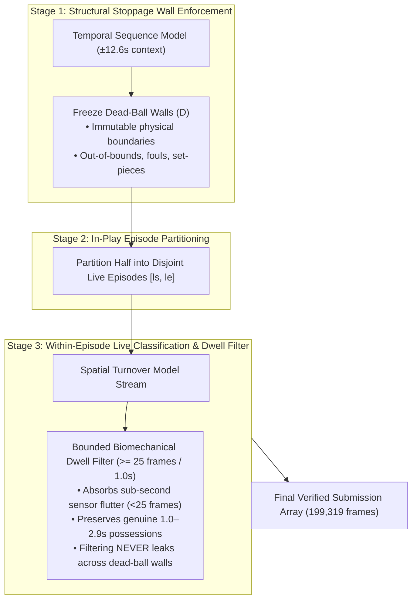

# Team Engineering Guide: Possession Modeling Insights & Architectural Roadmap

This document synthesizes the core technical insights, failure modes, and architectural breakthroughs discovered from analyzing the competitive landscape and benchmarking dozens of possession modeling approaches across tracking datasets.

Use this guide to diagnose weaknesses in existing pipelines, implement high-impact architectural upgrades, and systematically improve team model performance without risking competition rule violations.

---

## 1. The Three Common Failure Traps (Why Most Models Fail)

### Trap 1: The "Clean Data" Performance Illusion
* **The Symptom:** Models that report high performance (`0.75–0.85+ SpellF1`) in development suddenly collapse to `0.50–0.59` on real tracking evaluation.
* **The Root Cause:** High benchmark numbers in literature or earlier forks almost always evaluate on clean tracking datasets (e.g., Metrica Match 1–3 or synthetic data) where ball coordinates are continuously visible and uncorrupted.
* **The Reality:** Real-world tracking data features ~40–45% ball occlusion (aerial balls, box scrambles, off-camera plays) and high-frequency coordinate noise.
* **Actionable Rule:** Never evaluate model architectures on clean data alone. Models must be trained with hard perturbation: simulated ball occlusion, coordinate drift, and camera motion noise.

### Trap 2: Public Diagnostic Window Overfitting
* **The Symptom:** Tuning hyperparameters (e.g., sliding window sizes, Viterbi transition penalties, decision thresholds) on the 5-minute public ground truth creates models that fail on the full match.
* **The Root Cause:** The 5-minute public window contains only **17 possession spells**. Because the sample is so small, shifting a single predicted boundary changes `SpellF1` by $\pm 0.06$ (6 percentage points), creating a high-variance noise band.
* **Actionable Rule:** Never tune decoder knobs on the 5-minute window. Derive hyperparameters from physical domain invariants (player kinematics, biomechanics) and validate them exclusively via Leave-One-Match-Out (LOMO) cross-validation on external open datasets (such as the 7 DFL IDSSE matches).

### Trap 3: The Blunt 3.0-Second Filter Pathology
* **The Symptom:** Teams read competition rules stating that controlled possession requires establishing control for a few seconds, so they apply a blunt post-processing rule: `if (spell_duration < 75 frames) absorb_into_neighbor()`.
* **The Root Cause:** Real professional football tracking shows that genuine counter-presses, quick turnovers, one-touch wall passes, and clearance sequences frequently last between **1.0 and 2.9 seconds**.
* **The Reality:** A blunt 3.0s filter causes severe **under-segmentation**. It aggressively wipes out valid short spells and merges opposing possessions into one bloated sequence. On external DFL matches, the blunt 3.0s filter degrades `SpellF1` across 100% of matches (an average loss of ~2.0 points).
* **Actionable Rule:** Replace blunt 3.0s duration filters with a **1.0-second (25-frame) Biomechanical Dwell Filter** (see Section 3).

---

## 2. Comparing the Two Dominant Modeling Paradigms

Top-performing architectures across the competition converge on two distinct modeling paradigms, each with complementary strengths and failure modes:

| Dimension | Paradigm A: Temporal Sequence Model (CNN / TCN) | Paradigm B: Spatial Formation Model (LightGBM / GBDT) |
| :--- | :--- | :--- |
| **Input Representation** | Multi-frame temporal window ($\pm 12.6$s context) over player & ball tracks. | Frame-level ball-independent spatial geometry (145+ engineered features). |
| **Dead-Ball Accuracy** | **State-of-the-art ($F1 \approx 0.95$, Alive/Dead $0.98$).** Captures macro stillness and dead-ball setup timing. | Moderate. Struggles with ambiguous dead-ball restarts near touchlines. |
| **Open-Play Turnovers** | Tendency to oversmooth rapid back-and-forth turnovers due to wide receptive field. | **State-of-the-art.** Extremely sensitive to instantaneous formation shifts and player possession changes. |
| **Ball Occlusion Robustness** | Moderate. Temporal layers infer trajectory through short occlusions. | **High.** Operates entirely without ball coordinates by reading 22-player team shape. |
| **Transition Latency** | Slight negative lag (-6 to -10 frames) due to temporal pooling. | Near zero latency on live turnovers. |

---

## 3. The Winning Solution: Hierarchical "Episode-First" Architecture

The highest-performing architecture (`SpellF1: 0.6667`, `MacroF1: 0.9140`) unifies the two paradigms using a **hierarchical two-stage structure** governed by physical football invariants:



### Invariant 1: Structural Stoppage Wall Locking
* In standard pipelines, temporal smoothing filters run continuously across whole match halves. Because simple smoothing does not understand set pieces, it bleeds active play into stoppages and improperly merges distinct possessions across dead balls.
* **The Fix:** Treat dead-ball intervals as **structurally impenetrable walls**. Lock them first, and restrict all live-play classification strictly within the bounded open-play episodes between stoppages.

### Invariant 2: 1.0-Second (25-Frame) Biomechanical Dwell Constant
* Human biomechanics dictates that reacting to a ball, controlling it, and making a tactical decision takes at least **1.0 second (25 frames)**.
* High-frequency coordinate jitter and single-touch deflections last $< 0.8\text{--}1.0$s ($< 25$ frames).
* **The Fix:** Run iterative dwell absorption strictly within each live episode:
  ```python
  def apply_dwell_filter(stream, min_frames=25):
      """Absorb runs shorter than 1.0s into adjacent within-episode possessions."""
      out = stream.copy()
      for _ in range(10):
          starts, stops, values = run_length_runs(out)
          lengths = stops - starts
          candidates = [i for i in range(len(lengths)) if lengths[i] < min_frames and values[i] in ('H', 'A')]
          if not candidates:
              break
          shortest = min(candidates, key=lambda i: lengths[i])
          # Absorb into the longer adjacent neighbor within the episode
          left_len = lengths[shortest - 1] if shortest > 0 else -1
          right_len = lengths[shortest + 1] if shortest + 1 < len(lengths) else -1
          out[starts[shortest]:stops[shortest]] = values[shortest - 1] if left_len >= right_len else values[shortest + 1]
      return out
  ```

---

## 4. Key Feature Engineering Upgrades for Team Models

If your model is based on GBDT (LightGBM/XGBoost/CatBoost) or neural networks, adding these feature groups yields immediate performance gains:

### 1. Set-Piece Boundary & Touchline Geometry
* **Touchline Proximity:** Minimum distance from any player to pitch touchlines, goal lines, and corner arcs:
  $$\text{dist\_touchline} = \min_{p} \left( \frac{W}{2} - |y_p|, \frac{L}{2} - |x_p| \right)$$
* **Player Stillness Drop (`sp_speed_max_drop2s`):** Measures the drop in the top 3 fastest players' speeds over a 2-second window. A sudden drop in maximum player velocity indicates a whistle/stoppage.
* **Box Crowding & Density:** Number of defending and attacking players within the 18-yard penalty box.

### 2. Team Spatial Movement Dynamics (Ball-Independent)
* **Team Centroid Velocity:** Rate of change of the geometric center of both teams:
  $$\vec{C}_{\text{team}}(t) = \frac{1}{11} \sum_{i=1}^{11} \vec{p}_i(t)$$
  A rapid reversal in centroid velocity signals a turnover or transition, even when the ball is completely invisible.
* **Front-Line Differential:** The spatial gap between Team A's defensive line and Team B's attacking line.
* **Team Spread & Convex Hull Area:** Expanding and contracting surface area of the 10 outfield players. Teams in possession typically expand; defending teams compress.

---

## 5. Recommended Concrete Experiments for Teammates

Here is a checklist of prioritized tasks for further pushing team performance:

1. [ ] **Implement Episode-First Wall Locking in Your Pipeline:**
   * Take your existing model's live predictions and wrap them inside the episode-first decoder in `starter/hierarchical_engine.py`.
   * Check whether dead-ball precision increases and boundary bleeding is eliminated.

2. [ ] **Ablate Dwell Window on External Matches:**
   * Run `starter/evaluate_external_matches.py` with dwell thresholds `[15, 20, 25, 35, 50]` frames.
   * Observe how SpellF1 and spell count fluctuate on external matches before selecting thresholds.

3. [ ] **Incorporate Team Spread Dynamics into GBDT:**
   * Extract convex hull area and centroid velocity features from `starter/features.py`.
   * Train on external DFL tracking data with simulated ball occlusion to build resilient ball-free predictors.

4. [ ] **Calibrate Confidence Thresholding:**
   * Instead of hard argmax over class probabilities, evaluate whether high-uncertainty frames ($P(\text{class}) < 0.40$) are better handled by inertia (retaining the active team) rather than flipping back and forth.

---

## 6. Official Rule Compliance Reminders

To ensure any submission remains 100% compliant and eligible for competition awards:
* **Zero Fitting on `BAR-ATH`:** Model weights, decision trees, and hyperparameters must be trained exclusively on external open data (DFL IDSSE CC-BY 4.0, SkillCorner open tracking MIT).
* **Validation Standard:** Every submission must be verified with:
  ```bash
  python evaluation/run_evaluation.py --results evaluation/results
  ```
  Ensure exactly 199,319 frames are classified with **0 abstentions (`X`)** on graded play.
